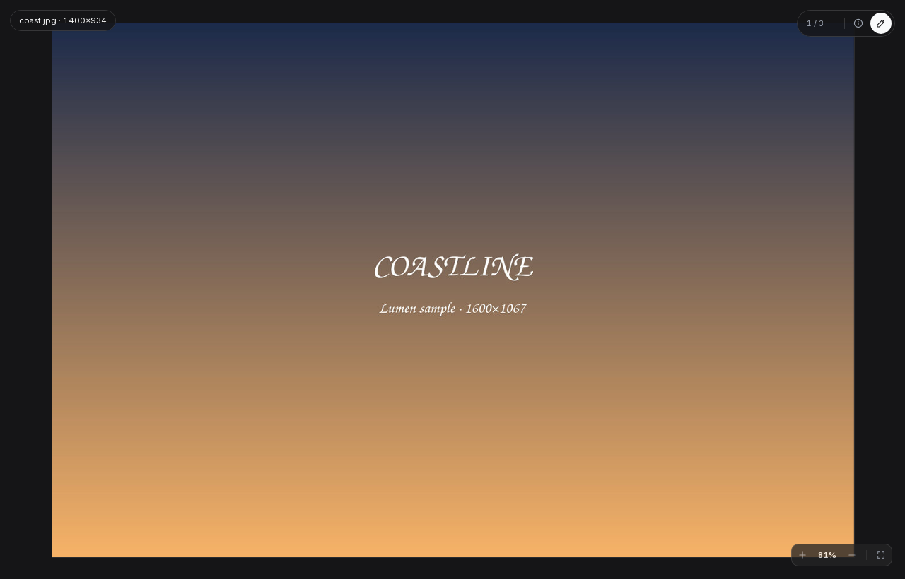
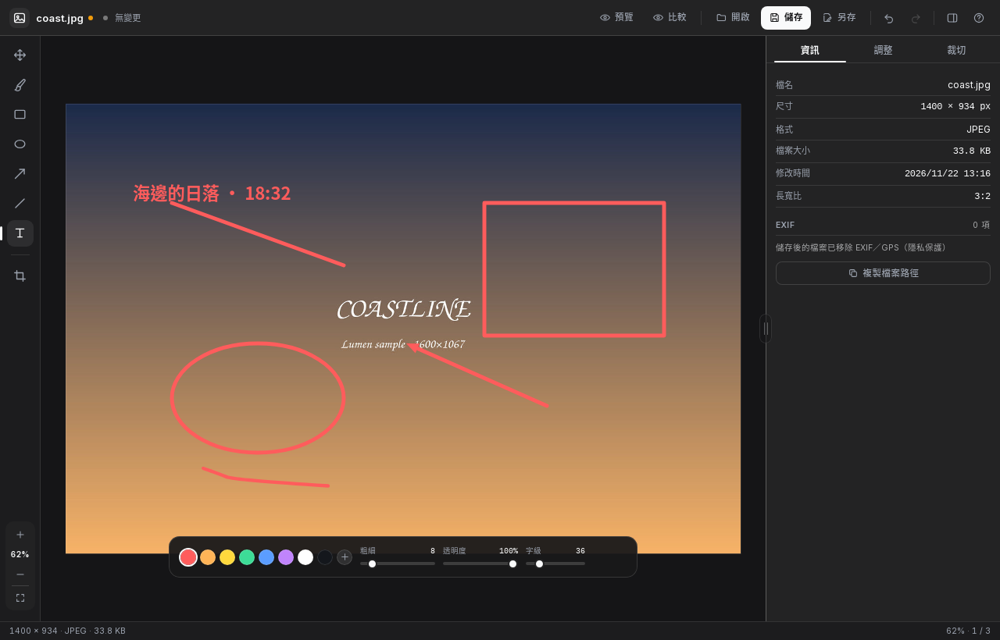

# Lumen

**English** · [繁體中文](README.zh-TW.md)

A lightweight image viewer for Linux that also annotates.
One 4 MB binary, no runtime, opens in ~55 ms — a drop-in replacement for the
preinstalled GNOME image viewer (Loupe).


| Preview | Edit |
|---|---|
|  |  |

## Why Lumen

| | **Lumen** | **Loupe** (GNOME Image Viewer) |
|---|---|---|
| **Built with** | Tauri 2 (Rust + system WebView), vanilla HTML/CSS | GTK4 / libadwaita (Rust) |
| **Footprint** | single **4 MB** ELF, zero runtime deps beyond `webkit2gtk` + GTK3 | full GNOME/GTK4 stack (or Flatpak runtime) |
| **Cold start** | ~55 ms to window, ~350 ms to the picture | feels instant, but heavier stack |
| **What it does** | view, **crop**, **resize**, **compress**, **annotate** | view, zoom, rotate, flip |
| **Annotations** | brush, line, rectangle, ellipse, two-point arrow, text — colour, width, opacity, dashed | — |
| **Crop / resize / compress to a target KB** | ✅ | — |
| **EXIF / GPS panel** | ✅ full EXIF, camera/lens/exposure/GPS | basic file properties |
| **Folder browsing** | ✅ built-in browser, ← → through the folder | open one file at a time |
| **Undo** | 80 steps, all edits stay non-destructive | — |
| **Privacy on save** | EXIF/GPS stripped from the saved file | n/a (no saving) |
| **Languages** | Traditional Chinese, Simplified Chinese, English (follows OS) | all GNOME languages |
| **Desktop integration** | one script: app menu entry, icon, desktop shortcut, optional default viewer | ships with GNOME |

Loupe is a fine viewer, and as a GNOME core app it integrates deeper. Lumen is for when you
want a *smaller, faster, zero-dependency* viewer that can also crop, resize, compress
and annotate without opening a second app.

## Install

**Download the binary** (Linux x86_64):

```bash
curl -L -o lumen https://github.com/limOvO/lumen/releases/latest/download/lumen
chmod +x lumen && ./lumen photo.jpg
```

Requires `gtk3` and `webkit2gtk-4.1` (Arch: `gtk3`, `webkit2gtk-4.1`).

**Build from source** (Rust 1.80+):

```bash
./scripts/build.sh                       # → dist/lumen
./scripts/install.sh                     # install to ~/.local (no sudo)
./scripts/install.sh --desktop-shortcut  # + desktop shortcut
./scripts/install.sh --set-default       # make it the default image viewer
./scripts/uninstall.sh                   # remove (only touches ~/.local)
```

Installs `~/.local/bin/lumen`, an app-menu entry and the icon set. More in
[packaging/INSTALL.md](packaging/INSTALL.md).

## Use

```bash
lumen                 # empty window: Ctrl+O or drag & drop
lumen photo.jpg       # open one image
lumen ~/Pictures      # open a folder
```

Lumen has two modes. It opens in **Preview** (clean picture, zoom, ← → between images,
`I` for the info card). Press **Edit** in the top-right corner — or `E` — to get the tool
rail, panels and annotation style bar; `Esc` goes back to Preview.

| Key | Action | Key | Action |
|---|---|---|---|
| `Ctrl+O` / `Ctrl+S` / `Ctrl+Shift+S` | open / save / save as | `Ctrl+Z` / `Ctrl+Shift+Z` | undo / redo |
| `←` `→` | previous / next image | `Home` `End` | first / last image |
| `+` `-` / `0` | zoom in / out / fit | wheel, `Ctrl+wheel` | zoom at cursor |
| `V` `B` `R` `O` `A` `L` `T` `C` | move / brush / rectangle / ellipse / arrow / line / text / crop | `Delete` | delete selected annotation |
| `Space` (hold) or middle-drag | pan canvas | `Esc` | deselect / back to Preview |
| `I` | info card | `F` / `?` | fullscreen / shortcut list |

**Formats:** JPEG, PNG, WebP, GIF (first frame), BMP, TIFF, AVIF, SVG, ICO.
Output: JPEG (white background), PNG, WebP.

**Language:** follows the OS — Traditional Chinese, Simplified Chinese, English for
everything else. Force it with `LUMEN_LANG=zh-Hans` (or `zh-Hant`, `en`).

## License

MIT.
