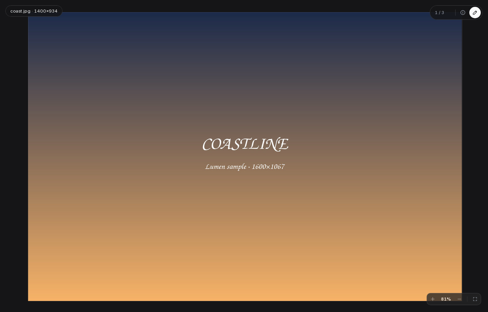

# Lumen 流明

> 一個夠輕量的圖片檢視器，順手就能改圖。
> Lightweight image viewer & annotator for Linux — a drop-in replacement for the
> preinstalled GNOME previewer (Loupe), built with Tauri 2 and vanilla web tech.

單一執行檔 4 MB、冷啟動到視窗出現約 **330 ms**（實測三次：325／329／332 ms）、
沒有任何 runtime 依賴（不用 Node、不用 Python、沒有 npm 套件）。
它把「看圖」做成主角：開檔即全螢幕預覽、方向鍵翻頁、滾輪縮放；要動手時，
裁切、縮放、壓縮、畫筆、矩形／圓框、箭頭與文字註譯都在同一個視窗裡完成。



## 啟動

- 視窗在 Rust `setup()` 就顯示（此時是深色底 `#101012`，不會白屏），實測**程序啟動後約 55ms 視窗就出現**；
  WebView 載入完成（約 230ms）畫出 splash，圖片解碼完成（約 350ms）就直接淡入 viewer。
- 加速手段：UI 模組改成並行載入、啟動圖片在 UI 初始化時同步預解碼、EXIF 與解碼並行、
  資料夾清單完全不阻塞第一幀。
- 從檔案管理器雙擊圖片啟動時，直接載入並著地在前景色預覽（`startup_files` 有檔就等它載完再顯示），
  不會先出現主界面。
- 沒有圖片時才會顯示空狀態的編輯器介面。

## 兩個階段：先看，再改

| 階段 | 什麼時候 | 看到什麼 |
|---|---|---|
| **預覽**（預設） | 開圖、翻頁、只是要看 | 乾淨的全幅圖片＋檔名／張數 chip、左右換頁、縮放；`I` 開資訊浮卡 |
| **編輯** | 要裁切、縮放、壓縮、畫註譯 | 完整工具列、右側面板、底片條、標註樣式 |

進入編輯請按右上角的「**編輯**」按鈕；編輯中按頂欄「**預覽**」或 `Esc` 回到預覽（`Esc` 會先取消選取／裁切）。
預覽階段的註譯仍然看得見，只是不能改——所見即你上次編輯的結果。

預覽是「看圖」而不是「畫布」：背景是純深色，只有透明圖（PNG／WebP／GIF／SVG）的透明區域才會看到棋盤格。
縮放的最小值就是「適應視窗」——不會縮成比視窗還小；一旦放大，就可以直接按住圖片拖曳查看，拖到邊界會自動停住。


## 介面

配色照設計知識庫《配色方案：深色》重做：`#151517` 頁面底、`#232324` 面板、`#101012` 畫布、
近白主色 `#F9FAFB`（主按鈕＝近白底＋深字）、邊框 `rgba(255,255,255,.14)`、語意色
`#22C55E / #F59E0B / #EF4444`；分層靠「表面亮一檔＋1px 邊框」而不是陰影。
動效走 120–280ms、`cubic-bezier(.2,.8,.25,1)`：階段切換時頂欄／工具列／面板／狀態列分批進出
（方向相反、時間錯開 30–40ms），畫布縮放用 280ms 緩動滑到新比例（不是硬跳），
按鈕 hover / 按下、工具選中指示條、分頁滑動指示條、樣式條喚醒、影像載入淡入都各自有過場；
`prefers-reduced-motion` 下全部關閉。

```
┌ 頂欄：檔名 · 存檔狀態 ─────────────── 預覽／比較／開啟／儲存／另存／復原／面板收合 ┐
│ 工具列 │ 畫布（底下浮出標註樣式工具條） │ 屬性面板（可拖寬 240–420、可收合） │
└ 狀態列：尺寸 · 格式 · 檔案大小 ───────────── 錯誤訊息 ───────── 縮放 · 張數 ┘
```

- 縮放控制（＋／比例／−／適應）在**編輯模式時豎排在左側工具列底部**，預覽模式則回到畫布右下角浮動；原本的 `1:1` 按鈕已移除。
- 預覽右上角只有**一顆 dock**（張數 · 資訊 ⓘ · 編輯 ✎），全部圖示、沒有文字；「開啟」按鈕已移除（改用 `Ctrl+O`／拖放）。
- 資訊浮卡：點卡片以外任何位置（或再按一次 ⓘ）就收起，開與關都是 200–220ms 的淡入／位移，不會瞬間消失。
- 預覽 ↔ 編輯切換時，版面會在該帧切換到最終尺寸（畫布原點固定），圖片則以 340ms 的單一 easeOutCubic
  沿直線滑到置中 fit 位置（切換帧會補償畫布原點位移，所以不會先「瞬移」一下）；頂欄／工具列／面板仍各自淡入滑出。
  兩個方向切換時**都會重新適應並置中**（就算在編輯模式被拖到畫布外或放大到 200%，回預覽或再進編輯都會平滑動畫回到 fit 狀態）。
- 視窗縮放、拖曳右側分隔把手時，圖片**每一帧都跟著重新適應**（即時 fit），不會等到放開才跳一次。
- 預覽階段用 `←`/`→`（或邊緣箭頭）換圖時有**左右方向感**的過渡：`→` 時舊圖往左滑出、新圖從右側滑入；`←` 反向。
  260ms、`easeOutCubic`，同時淡出，不是硬切。
- 右側邊界有一顆把手：**往左拖 = 面板變寬**、往右拖 = 變窄（`240–420px`，記在 `localStorage`）；拖曳時圖片每一帧即時跟隨。頂欄最右可以整塊收合（收合／展開有 240ms 版面動畫，圖片同步縮放）。
- 箭頭是「兩點式」：按 `A` 後點一下設起點、再點一下設終點（也可以一筆拖完）；選取時只有起點的兩顆圓點可拖，不會出現外框。
- 標註樣式不是常駐面板，而是**只在畫筆／矩形／圓框／箭頭／文字工具時**浮在畫布下方；它預設是「睡著」的（半透明、往下縮），只有**游標靠近**（醒著＋睡著兩個位置聯集成的帶狀區）或移上去才會醒來。
- 切換到繪圖工具時，樣式條會從畫布下方**滑升淡入**到「睡著」位置（240ms）；切回移動工具時再**下滑淡出**（180ms）——有進場／退場，但不會先亮一下再縮回去。
- 沒有浮動 toast：存檔狀態直接顯示在頂欄（無變更／儲存中／已儲存／儲存失敗），其他提示與錯誤進底部狀態列。
- 編輯模式可以「到處拖動」：移動工具在任何位置按住都能平移畫面（含圖片上），而且**可以拖超過畫布邊界**（把圖推出畫面也允許，方便對照邊角）；其他工具用**中鍵拖曳**或**按住空白鍵**也能平移。預覽階段則仍會把圖片夾在視窗內。

## 功能

| 分類 | 內容 |
|---|---|
| 預覽 | 開檔即適應視窗、滾輪／`+`/`-` 縮放（0.02×–16×，以畫面中心為錨點、不可拖曳）、點縮放比例回到適應視窗、同資料夾 `←`/`→` 翻頁、底片條快速跳檔 |
| 圖片資訊 | 檔名、尺寸、格式、檔案大小、修改時間、長寬比，以及 EXIF（相機、鏡頭、快門、光圈、ISO、焦距、拍攝時間、GPS、方向） |
| 裁切 | 選裁切工具就自動出現 80% 置中框（不用先拖）；自由／原始比例／1:1／4:3／3:2／16:9，8 個把手、三分線、Shift 鎖比例；離開裁切工具框就消失（按「套用裁切」則保留設定供匯出） |
| 縮放 (resize) | 長邊上限或指定寬高（鎖比例）、百分比預設，匯出時重取樣 |
| 壓縮 | JPEG／PNG／WebP 品質滑桿、即時預估檔案大小、以目標 KB 反推品質（二分搜尋）；實測 1600×1067 指定 60 KB → 59.6 KB |
| 註譯 | 畫筆（速度感筆觸）、矩形、圓框／橢圓、**直線**、**兩點式箭頭**（點起點→點終點；選取後拖兩端圓點）、文字；顏色、粗細、透明度、**虛線**（色票列最後一顆圖示按鈕，筆跡／直線／圖案都適用；文字工具時自動隱藏）；無填色，一律描邊 |
| 編輯 | 復原／重做（80 步）、選取後拖移／縮放／刪除、比較原圖、未存變更提示 |
| 檔案 | 開檔（內建資料夾瀏覽器，可逐層進入子資料夾）、拖放開檔、另存（格式／品質／路徑）、存回原檔、頂欄存檔狀態、單一實例（從檔案管理器再開一張不會長出第二個視窗） |
| 隱私 | 存檔時不寫回 EXIF／GPS；原檔的中繼資料只留在畫面顯示，不會被複製到輸出檔 |

## 為什麼輕量

- **原生外殼 + 原生解碼**：Rust 只負責檔案與 EXIF，影像解碼交給 WebKit 的原生
  codec（`createImageBitmap`），沒有 Node、沒有打包器、沒有 npm 依賴；
  整個 App 就是一個 4 MB 的 ELF，冷啟動 ~330 ms。
- **不烘焙**：所有註譯都是向量物件（原圖像素座標），復原／重做只是陣列操作，
  存檔時才一次合成。
- **雙畫布**：底層只畫「圖 + 已提交註譯」，上層只畫「進行中的筆畫與選取框」，
  畫筆移動時只重畫一小段，4000×3000 的圖也能順順地畫。
- **記憶體**：實測閒置約 280 MB、開一張圖約 310 MB（PSS，含 WebKit 子行程，
  軟體渲染的 headless 量測）。這是 WebKitGTK 的基底成本，和 GNOME Loupe 同級；
  Lumen 換來的是 4 MB 執行檔與 0.3 秒啟動。

## 建置與安裝

需要：Rust 1.80+、GTK3、webkit2gtk-4.1（Arch: `webkit2gtk-4.1`、`gtk3`）。

```bash
./scripts/build.sh                    # 產出 dist/lumen（附 --version smoke test）
./scripts/install.sh                    # 安裝到 ~/.local（執行檔、圖示、應用程式選單）
./scripts/install.sh --desktop-shortcut # 再放一個「Lumen」捷徑到桌面
./scripts/install.sh --set-default      # 同時用 xdg-mime 設為圖片預設開啟程式
./scripts/uninstall.sh                  # 解除安裝（含桌面捷徑，只動 ~/.local）
```

全部安裝在使用者家目錄，不需要 `sudo`、不改系統套件。安裝位置：

| 路徑 | 內容 |
|---|---|
| `~/.local/bin/lumen` | 執行檔 |
| `~/.local/share/icons/hicolor/<16–512>/apps/lumen.png` | 應用程式圖示 |
| `~/.local/share/applications/lumen.desktop` | 應用程式選單項目（`Exec` 已改為絕對路徑） |
| `~/桌面/Lumen.desktop`（`--desktop-shortcut`） | 桌面啟動圖示（已標記 trusted） |

`install.sh` 是冪等的：重複執行只覆蓋同名檔案，並順帶更新 desktop database
與 icon cache。`--set-default`（別名 `--default-viewer`）是選用的，會把
PNG／JPEG／WebP／GIF／BMP／TIFF／AVIF／SVG 的預設開啟程式指向 Lumen。

手動建置（本機 `~/.cargo` 唯讀、`/tmp` 不持久，所以 `CARGO_HOME` 要指到專案內）：

```bash
CARGO_HOME="$PWD/.cache/cargo-home" \
  cargo build --release --manifest-path src-tauri/Cargo.toml
./src-tauri/target/release/lumen path/to/image.jpg
```

詳細安裝說明、圖示重新產生與疑難排解見 [packaging/INSTALL.md](packaging/INSTALL.md)。

> `scripts/build.sh` 會把 `CARGO_HOME` 指到專案內 `.cache/cargo-home`，避免動到
> 使用者家目錄的 cargo 設定；`.cache/` 可安全刪除。

## 使用

```bash
lumen                      # 開空視窗，用 Ctrl+O 或拖放開檔
lumen photo.jpg            # 直接開圖
lumen ~/Pictures            # 開啟資料夾
```

### 快捷鍵

| 鍵 | 動作 | 鍵 | 動作 |
|---|---|---|---|
| `Ctrl+O` | 開啟檔案 | `Ctrl+S` | 儲存 |
| `Ctrl+Shift+S` | 另存 | `Ctrl+Z` / `Ctrl+Shift+Z` | 復原／重做 |
| `←` `→` | 上一張／下一張 | `+` `-` | 放大／縮小 |
| `0` | 適應視窗（點左欄比例數字同效） | `Ctrl+滾輪` | 以游標為錨點縮放 |
| `V` | 移動／選取 | `B` | 畫筆 |
| `R` | 矩形 | `O` | 圓框 |
| `A` | 箭頭 | `T` | 文字 |
| `C` | 裁切 | `Delete` | 刪除選取 |
| `Space`（按住） | 暫時平移 | 滾輪／中鍵拖曳 | 平移 |
| `Ctrl+滾輪` | 以游標為錨點縮放 | `Esc` | 取消選取／離開裁切 |
| `F` | 全螢幕 | `?` | 快捷鍵說明 |
| `I` | 資訊（預覽中＝浮卡） | `Esc` | 回預覽（先取消選取／裁切） |
| `-` | 縮小（最小到適應視窗） | 拖曳 | 放大後可平移，fit 時不動作 |
| `Home` `End` | 第一張／最後一張 | `V` `B` `R` `O` `A` `T` `C` | 移動／畫筆／矩形／圓框／箭頭／文字／裁切 |

## 架構

```
src/
  index.html            UI 外殼
  css/tokens.css        設計變數（色彩、間距、動效）
  css/app.css           版面與元件
  js/main.js            開機、Tauri 橋接、文件生命週期、渲染排程、actions
  js/core/state.js      狀態容器 + undo/redo + 訂閱
  js/core/loader.js     讀檔、magic 判斷、EXIF 方向、巨圖降採樣
  js/core/viewport.js   縮放／平移數學、棋盤格、繪製
  js/core/annotate.js   註譯物件模型、渲染、命中測試
  js/core/interaction.js 畫布手勢（筆刷、形狀、文字、裁切、平移、選取）
  js/core/export.js     合成、編碼、目標大小壓縮
  js/ui/*.js            頂欄、工具列、面板、底片條、瀏覽器、另存、toast、快捷鍵
src-tauri/
  src/main.rs           檔案列舉、EXIF、視窗、單一實例
  tauri.conf.json       視窗與 asset protocol 設定
packaging/              .desktop、圖示
scripts/                build / install / uninstall
```

狀態是單一來源（`state.js`），任何修改都走 `commit()` 留下快照；renderer 只讀狀態。
註譯一律存**原圖像素座標**，因此縮放、裁切、重設尺寸都只是同一個物件的不同視圖。

### 開發用樣本

`src/samples/` 有三張示範圖；在瀏覽器直接開 `src/index.html`（沒有 Tauri 時）
會用這幾張圖跑 mock 模式，方便調 UI。

### 檔案格式支援

JPEG、PNG、WebP、GIF（第一格）、BMP、TIFF、AVIF、SVG（點陣化）、ICO。
輸出：JPEG（自動鋪白底）、PNG、WebP。

## 授權

MIT。
