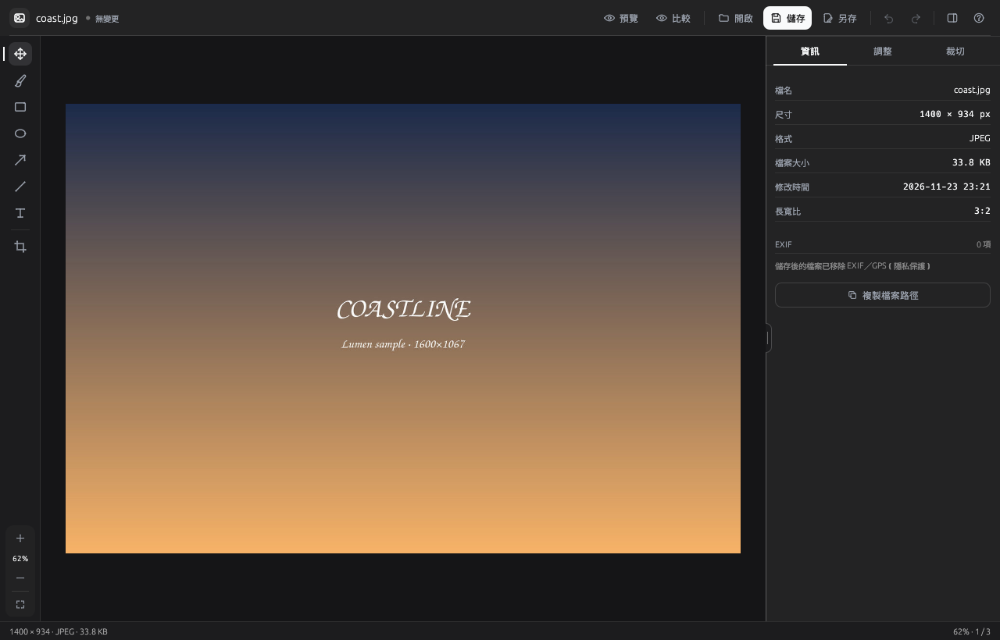

# Lumen

**A fast, small image viewer and annotator for Linux.**
Lumen opens the photo before you finish clicking — and stays out of the way
afterwards. This repository contains the **Rust + wgpu + egui rewrite** of the
original Tauri/WebKit app (kept alongside for reference).

[繁體中文](README.zh-TW.md) · [Parity matrix](docs/parity.md) · [Benchmarks](docs/bench-resources.md) · [Architecture](docs/architecture.md)




## Why Lumen

- **Opens instantly.** ~87 ms from launch to visible photo (and ~3 ms to switch
  to the next image), against 204–331 ms for Loupe and 444–464 ms for the
  original WebKit build on the same machine.
- **Small and quiet.** One 9.6 MB binary, ~135 MB PSS with software GL, **0.0 %
  idle CPU** — it does not repaint when nothing happens.
- **Actually editable.** Brush, line, rectangle, ellipse, arrow and text
  annotations (colour, width, opacity, dashed), crop with ratio presets, resize,
  and target-KB compression to JPEG/PNG/WebP.
- **Native by default.** System GTK file chooser for open/save-as, system CJK
  font for text, single-instance forwarding from the file manager, drag &
  drop, and a desktop shortcut.
- **Keeps your habits.** The keyboard model, layout, palette and motion of the
  original app are preserved and checked by an automated parity harness
  (70 checks against the original build).

## Benchmarks

Measured headless with software GL (llvmpipe) for all three apps, median of 3 —
see [docs/bench-resources.md](docs/bench-resources.md) for method and the full
table.

| | **Lumen (egui)** | Lumen (Tauri/WebKit) | Loupe 51.2 |
|---|---|---|---|
| Time to photo · 1.3 MP | **87 ms** | 444 ms | 204 ms |
| Time to photo · 12 MP | **85 ms** | 464 ms | 331 ms |
| Window shown | 85–87 ms | 85–94 ms | 138–141 ms |
| Switch to next image | **3 ms** | browser decode | — |
| PSS (process tree) | **135 MB** | 338 MB | 229 MB |
| Anonymous memory | 78 MB | 166 MB | **67 MB** |
| Peak RSS | **400 MB** | 697 MB | 644 MB |
| Threads / FDs | **68 / 41** | 186 / 197 | 147 / 122 |
| Idle CPU | **0.0 %** | 2.2 % | 5.2 % |
| Binary | 9.6 MB | 4 MB + system WebKit (141 MB) | 8 MB + system GTK (54 MB) |

## Install

Dependencies (Arch names): `gtk3` (native file chooser), `libjpeg-turbo`
(fast preview decoding), and a system CJK font such as `noto-fonts-cjk`.

```bash
git clone https://github.com/limOvO/lumen
cd lumen

scripts/build-egui.sh                 # → dist/lumen-egui (size-optimised)
scripts/install-egui.sh               # → ~/.local/bin/lumen-egui + desktop entry
scripts/install-egui.sh --desktop-shortcut
scripts/install-egui.sh --set-default # make it the default image viewer
```

Prebuilt binaries are attached to the GitHub releases.

## Use

```bash
lumen-egui photo.jpg          # open a file
lumen-egui ~/Pictures         # or a folder (starts with the first image)
```

| Keys | Action |
|---|---|
| ← / → | previous / next image |
| `+` / `-` / `0` | zoom in / out / fit (fit is the minimum) |
| wheel · drag | zoom at cursor · pan (only when zoomed) |
| `I` | info card |
| `E` | viewer ⇄ editor |
| `V B L R O A T C` | move · brush · line · rectangle · ellipse · arrow · text · crop |
| `Shift` while dragging | square / circle / 45° lines |
| `Ctrl+O` / `Ctrl+S` / `Ctrl+Shift+S` | open · save · save as (native chooser) |
| `Ctrl+Z` / `Ctrl+Shift+Z` / `Delete` | undo (80 steps) · redo · delete selection |
| `F` · `?` · `Esc` | fullscreen · shortcuts · cancel/back |

Languages follow the system locale (`zh-Hant`, `zh-Hans`, `en`); override with
`LUMEN_LANG=en`.

## Build from source

```bash
cargo build --release --manifest-path egui-app/Cargo.toml   # ~1 min
cargo test  --release --manifest-path egui-app/Cargo.toml   # 131 tests

scripts/parity/verify.py        # 69 parity checks vs the original build
scripts/bench-egui.sh 3         # time-to-photo, window time, PSS
scripts/bench-resources.sh 3    # memory / CPU / threads / FDs
```

The release profile is size-first (`opt-level="z"`, fat LTO, `codegen-units=1`,
stripped): 15.2 MB → 9.6 MB with no measurable speed regression. Preview decoding
uses libjpeg-turbo's scaled IDCT; neighbour previews are prefetched so switching
images is a texture upload.

## Repository layout

```
egui-app/          Rust + wgpu + egui rewrite (the active build)
  src/             app, canvas interaction, annotations, crop, export, save,
                   native dialogs, i18n, fonts, single instance
src/               original Tauri/WebKit frontend (reference build)
src-tauri/         original Tauri shell
scripts/           build/install, benchmarks, parity harness, i18n + font generators
docs/              parity matrix, benchmarks, architecture notes
packaging/         desktop entry + icons
```

## License

MIT — see [LICENSE](LICENSE).
