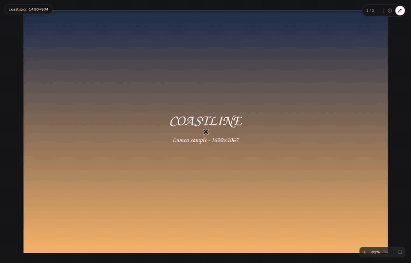

# Lumen 流明

> 一個夠輕量的圖片檢視器，順手就能改圖。
> Lightweight image viewer & annotator for Linux — a drop-in replacement for the
> preinstalled GNOME previewer, built with Tauri 2 and vanilla web tech.

單一執行檔 **4 MB**、零 runtime 依賴（不用 Node／Python／npm）、冷啟動到視窗出現約 **55 ms**。
開檔就是全幅預覽，方向鍵翻頁；要動手時，裁切、縮放、壓縮、標註都在同一個視窗完成。



| 預覽 | 編輯 |
|---|---|
|  |  |

## 功能

- **檢視**：開檔即適應視窗、滾輪／`+`／`-` 縮放（最小＝適應視窗、放大後可拖曳平移）、同資料夾 `←`/`→` 翻頁、`I` 開資訊浮卡（檔名、尺寸、格式、大小、時間、長寬比、完整 EXIF／GPS）。
- **裁切**：選工具即出現 80% 置中框；自由／原始比例／1:1／4:3／3:2／16:9、8 個把手、三分線、Shift 鎖比例。
- **縮放與壓縮**：長邊上限或指定寬高（鎖比例）；JPEG／PNG／WebP 品質滑桿與即時預估，可用「目標 KB」反推品質。
- **標註**：畫筆（速度感筆觸）、直線、矩形、圓框、兩點式箭頭、文字；顏色、粗細、透明度、虛線。
- **編輯**：復原／重做 80 步、選取後移動／縮放／刪除、比較原圖、存回原檔或另存。
- **檔案**：內建資料夾瀏覽、拖放開檔、單一實例（不會開出第二個視窗）。
- **隱私**：存檔時不寫回 EXIF／GPS，原檔中繼資料只留在畫面顯示。

## 優點

- **真的輕**：一個 4 MB ELF，沒有打包器、沒有 npm 依賴、沒有內建 codec——影像解碼交給 WebKit 原生實作。
- **快**：約 55 ms 出現視窗（深色 splash，不會白屏）、約 350 ms 看到圖片；UI 模組並行載入、開檔與 UI 初始化同時進行。
- **非破壞性**：標註是向量物件（存原圖像素座標），復原只是陣列操作，匯出時才一次合成。
- **畫大圖也順**：雙畫布（底層圖＋已提交標註、上層進行中的筆畫與選取框），筆刷只重畫差異區。
- **鍵盤友善**：幾乎所有操作都有快捷鍵；`?` 隨時叫出總表。
- **三語系**：跟隨系統語言（繁中／簡中／英文，非繁簡一律英文），可用 `LUMEN_LANG` 覆寫。

## 架構

```
┌──────────────── Tauri 外殼（Rust，src-tauri/src/main.rs）────────────────┐
│ 檔案列舉 · EXIF 讀取 · 圖片位元組 · 視窗控制 · 單一實例 socket · ui_locale │
└────────────────────────────────┬─────────────────────────────────────────┘
                                 │ invoke / event（bridge，src/js/main.js）
┌────────────────────────────────▼──── WebView（無 bundler、原生 ESM）────┐
│ main.js      開機排程 · 階段（預覽／編輯）切換 · actions · 渲染排程        │
│ core/        state（狀態＋undo） · loader（解碼） · viewport（縮放數學）   │
│              annotate（標註物件） · interaction（手勢） · export（匯出）  │
│              i18n（三語系）                                              │
│ ui/          頂欄 · 工具列 · 面板 · 瀏覽器 · 另存 · 快捷鍵 · 樣式條      │
└────────────────────────────────┬─────────────────────────────────────────┘
                                 │ 雙層 canvas：board（圖＋已提交標註）＋ overlay（進行中／選取框）
                                 ▼
                        畫布顯示 ← state 單一來源
```

```
src/
  index.html             UI 外殼
  css/tokens.css         設計變數（色彩、間距、動效）
  css/app.css            版面與元件
  js/main.js             開機、Tauri 橋接、文件生命週期、渲染排程
  js/core/state.js       狀態容器 + undo/redo + 訂閱
  js/core/loader.js      讀檔、格式判斷、EXIF 方向、巨圖降採樣
  js/core/viewport.js    縮放／平移數學、棋盤格、繪製
  js/core/annotate.js    標註物件模型、渲染、命中測試
  js/core/interaction.js 手勢：筆刷、形狀、文字、裁切、平移、選取
  js/core/export.js      合成、編碼、目標大小壓縮
  js/core/i18n*.js       多語系（字串表由 scripts/gen-i18n.py 產生）
  js/ui/*.js             頂欄、工具列、面板、瀏覽器、另存、快捷鍵
src-tauri/
  src/main.rs            檔案、EXIF、視窗、單一實例
  tauri.conf.json        視窗與 asset protocol 設定
packaging/               .desktop、圖示
scripts/                 build / install / uninstall / gen-i18n
```

**設計要點**

- 狀態是單一來源（`state.js`），所有修改走 `commit()` 留下快照；renderer 只讀狀態。
- 標註一律存**原圖像素座標**，縮放、裁切、重設尺寸都只是同一個物件的不同視圖。
- 匯出流程：`export.flatten()` 依裁切／尺寸重繪 → `encode()` 依格式編碼（JPEG 自動鋪白底）→ 目標大小時二分搜尋品質。
- 從檔案管理器再開一張圖時，透過 Unix socket 轉給已開啟的實例（`lumen://open` 事件）。

## 安裝

### 下載執行檔

```bash
curl -L -o lumen https://github.com/limOvO/lumen/releases/latest/download/lumen
chmod +x lumen && ./lumen photo.jpg
```

需要 GTK3 與 `webkit2gtk-4.1`（Arch：`gtk3`、`webkit2gtk-4.1`）。

### 從原始碼建置

```bash
./scripts/build.sh                       # 產出 dist/lumen
./scripts/install.sh                     # 安裝到 ~/.local（不需 sudo）
./scripts/install.sh --desktop-shortcut  # 加一個桌面捷徑
./scripts/install.sh --set-default       # 設為圖片預設開啟程式
./scripts/uninstall.sh                   # 解除安裝（只動 ~/.local）
```

安裝位置：`~/.local/bin/lumen`、`~/.local/share/applications/lumen.desktop`、`~/.local/share/icons/hicolor/*/apps/lumen.png`。
需要 Rust 1.80+；細節與疑難排解見 [packaging/INSTALL.md](packaging/INSTALL.md)。

## 使用

```bash
lumen                 # 空視窗：Ctrl+O 或拖放開檔
lumen photo.jpg       # 直接開圖
lumen ~/Pictures      # 開資料夾
```

- **預覽**（預設）：乾淨的全幅畫面，只能看不能畫；右上角一顆 dock（張數 · 資訊 ⓘ · 編輯 ✎）。
- **編輯**：按右上「編輯」進入；頂欄「預覽」或 `Esc` 回到預覽。

| 鍵 | 動作 | 鍵 | 動作 |
|---|---|---|---|
| `Ctrl+O` / `Ctrl+S` / `Ctrl+Shift+S` | 開啟／儲存／另存 | `Ctrl+Z` / `Ctrl+Shift+Z` | 復原／重做 |
| `←` `→` | 上一張／下一張 | `Home` `End` | 第一張／最後一張 |
| `+` `-` / `0` | 放大／縮小／適應視窗 | 滾輪、`Ctrl+滾輪` | 縮放（以游標為錨點） |
| `V` `B` `R` `O` `A` `L` `T` `C` | 移動／畫筆／矩形／圓框／箭頭／直線／文字／裁切 | `Delete` | 刪除選取標註 |
| `Space`（按住）、中鍵拖曳 | 平移畫布 | `Esc` | 取消選取／回到預覽 |
| `I` | 資訊浮卡（預覽） | `F` / `?` | 全螢幕／快捷鍵說明 |

**語言**：跟隨系統——`zh-TW/HK/MO` → 繁中、`zh-CN/SG` → 簡中、其他一律英文；可用 `LUMEN_LANG=zh-Hans`（或 `zh-Hant`／`en`）固定。

**支援格式**：JPEG、PNG、WebP、GIF（第一格）、BMP、TIFF、AVIF、SVG、ICO；輸出 JPEG（自動鋪白底）、PNG、WebP。

## 授權

MIT。
