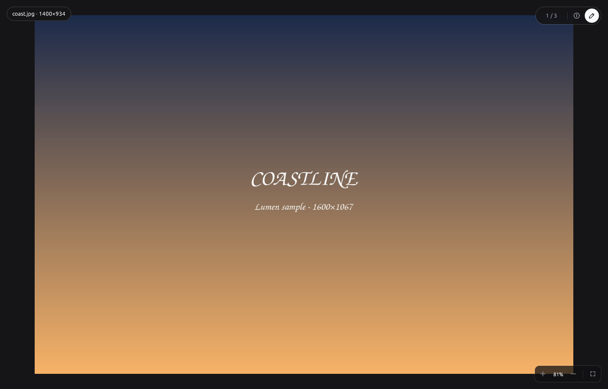
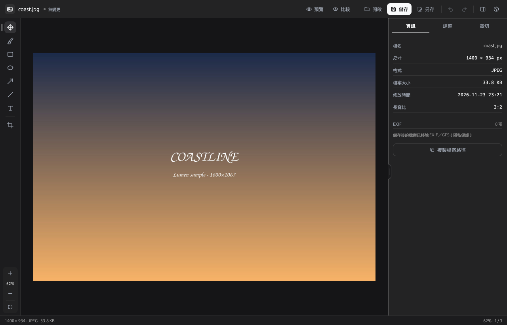

# Lumen

**輕巧、極快的 Linux 圖片檢視與標註工具。**
照片在你點完之前就已經出現，而且不會打擾你。這個 repo 包含原本
Tauri/WebKit 版本的 **Rust + wgpu + egui 重寫版**（原版保留作為對照）。

[English](README.md) · [Parity 對照表](docs/parity.md) · [效能數據](docs/bench-resources.md) · [架構](docs/architecture.md)




## 為什麼選 Lumen

- **幾乎是瞬間開啟**：啟動到看到照片約 **87 ms**、切換下一張約 **3 ms**；
  同機對照 Loupe 204–331 ms、原 WebKit 版 444–464 ms。
- **小而安靜**：單一 9.6 MB 執行檔、軟體 GL 下 PSS 約 135 MB、**閒置 CPU 0.0 %**
  —— 沒有事情發生時完全不重繪。
- **真的能編輯**：筆刷、直線、矩形、圓框、箭頭、文字標註（顏色／粗細／透明度／
  虛線）、裁切與比例預設、縮放、目標 KB 壓縮（JPEG／PNG／WebP）。
- **原生整合**：系統 GTK 選檔對話框、系統 CJK 字型、從檔案管理員開啟時的
  單一實例轉發、拖放開圖、桌面捷徑。
- **保留原本手感**：鍵盤配置、版面、配色、動效都與原版一致，並以自動化
  parity harness（70 項檢查）對照原版驗證。

## 效能

三套程式都在同一台機器、無頭 Xvfb + 軟體 GL（llvmpipe）下量測，取 3 次中位數；
方法與完整表格見 [docs/bench-resources.md](docs/bench-resources.md)。

| | **Lumen (egui)** | Lumen (Tauri/WebKit) | Loupe 51.2 |
|---|---|---|---|
| 看到圖 · 1.3 MP | **87 ms** | 444 ms | 204 ms |
| 看到圖 · 12 MP | **85 ms** | 464 ms | 331 ms |
| 開窗時間 | 85–87 ms | 85–94 ms | 138–141 ms |
| 切換下一張 | **3 ms** | 瀏覽器解碼 | — |
| PSS（含子程序） | **135 MB** | 338 MB | 229 MB |
| 匿名記憶體 | 78 MB | 166 MB | **67 MB** |
| 峰值 RSS | **400 MB** | 697 MB | 644 MB |
| 執行緒 / FD | **68 / 41** | 186 / 197 | 147 / 122 |
| 閒置 CPU | **0.0 %** | 2.2 % | 5.2 % |
| 執行檔 | 9.6 MB | 4 MB ＋系統 WebKit 141 MB | 8 MB ＋系統 GTK 54 MB |

## 安裝

相依（Arch 套件名）：`gtk3`（系統選檔對話框）、`libjpeg-turbo`（快速預覽解碼）、
系統 CJK 字型（如 `noto-fonts-cjk`）。

```bash
git clone https://github.com/limOvO/lumen
cd lumen

scripts/build-egui.sh                 # → dist/lumen-egui（size 最佳化）
scripts/install-egui.sh               # → ~/.local/bin/lumen-egui ＋ desktop entry
scripts/install-egui.sh --desktop-shortcut
scripts/install-egui.sh --set-default # 設為預設圖片檢視器
```

GitHub Releases 也有預先編譯的執行檔。

## 使用

```bash
lumen-egui 圖片.jpg          # 開檔
lumen-egui ~/圖片            # 或開資料夾（從第一張開始）
```

| 按鍵 | 動作 |
|---|---|
| ← / → | 上一張 / 下一張 |
| `+` / `-` / `0` | 放大 / 縮小 / 回到 fit（fit 是最小值） |
| 滾輪 · 拖曳 | 以游標位置縮放 · 平移（放大後才可） |
| `I` | 資訊浮卡 |
| `E` | 檢視 ⇄ 編輯 |
| `V B L R O A T C` | 移動 · 筆刷 · 直線 · 矩形 · 圓框 · 箭頭 · 文字 · 裁切 |
| 拖曳時按 `Shift` | 正方形／圓形／45° 直線 |
| `Ctrl+O` / `Ctrl+S` / `Ctrl+Shift+S` | 開啟 · 儲存 · 另存（系統選檔對話框） |
| `Ctrl+Z` / `Ctrl+Shift+Z` / `Delete` | 復原（80 步）· 重做 · 刪除選取 |
| `F` · `?` · `Esc` | 全螢幕 · 快捷鍵 · 取消／返回 |

語系跟隨系統（繁中／簡中／英文），可用 `LUMEN_LANG=en` 覆寫。

## 從原始碼建置

```bash
cargo build --release --manifest-path egui-app/Cargo.toml   # 約 1 分鐘
cargo test  --release --manifest-path egui-app/Cargo.toml   # 131 項測試

scripts/parity/verify.py        # 70 項與原版對照的檢查
scripts/bench-egui.sh 3         # 看到圖時間、開窗時間、PSS
scripts/bench-resources.sh 3    # 記憶體 / CPU / 執行緒 / FD
```

release profile 以體積優先（`opt-level="z"`、fat LTO、`codegen-units=1`、strip）：
15.2 MB → 9.6 MB，速度沒有可測量的退化。預覽解碼走 libjpeg-turbo 的 scaled
IDCT，相鄰圖片預先解碼，所以切圖只是貼圖上傳。

## 目錄結構

```
egui-app/          Rust + wgpu + egui 重寫（目前的主要版本）
src/               原 Tauri/WebKit 前端（對照版）
src-tauri/         原 Tauri 外殼
scripts/           建置／安裝、benchmark、parity harness、i18n 與字型生成
docs/              parity 對照表、效能數據、架構說明
packaging/         desktop entry 與圖示
```

## 授權

MIT — 見 [LICENSE](LICENSE)。
